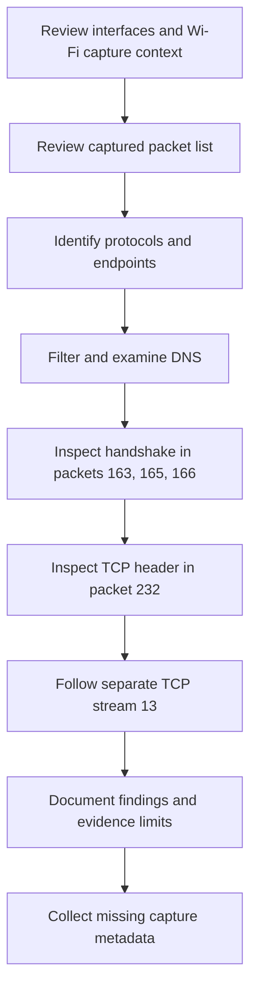
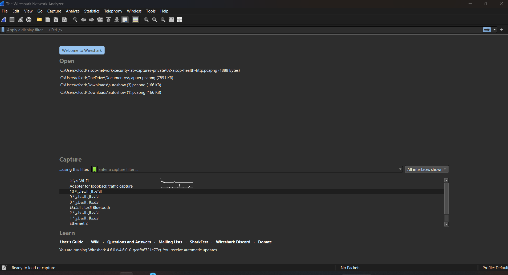
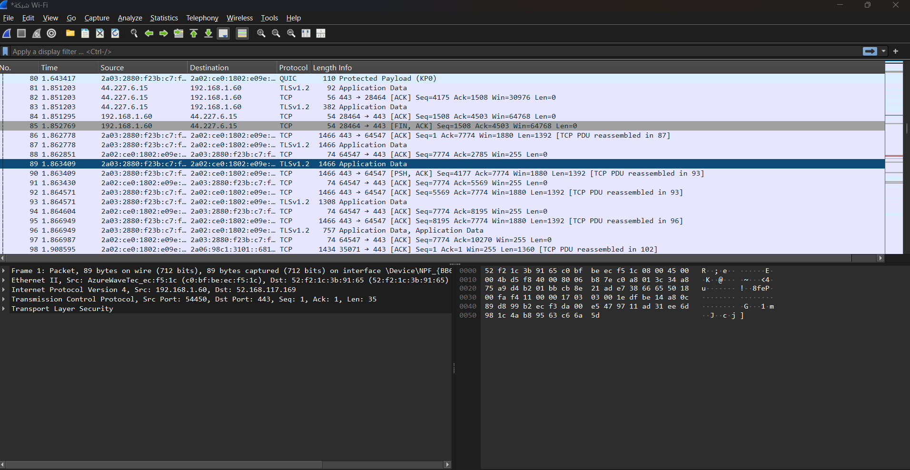
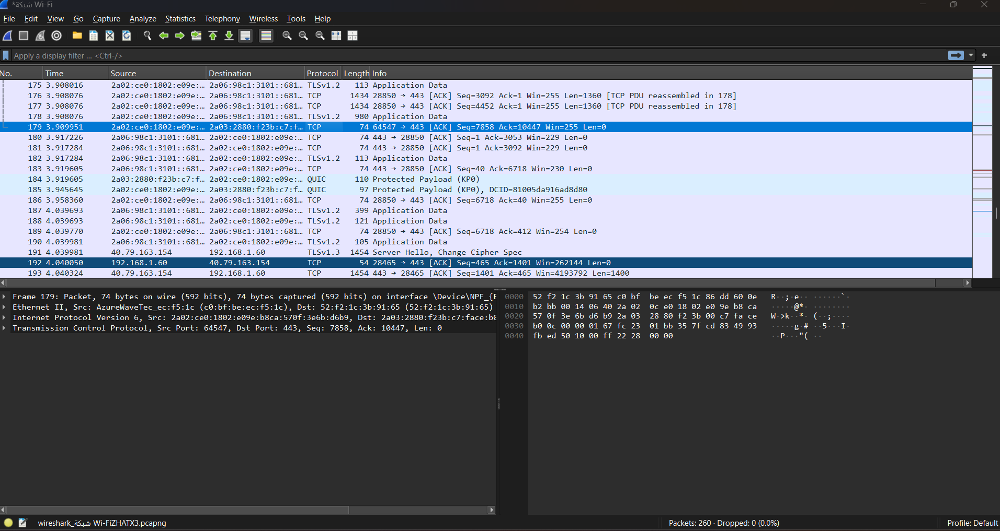
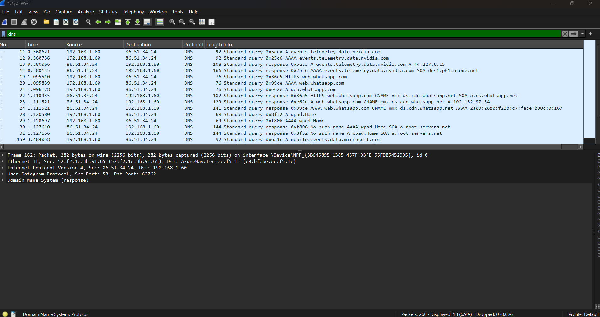
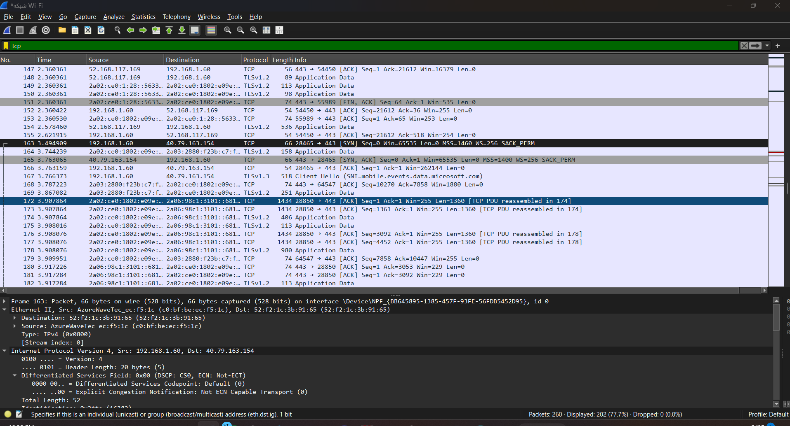
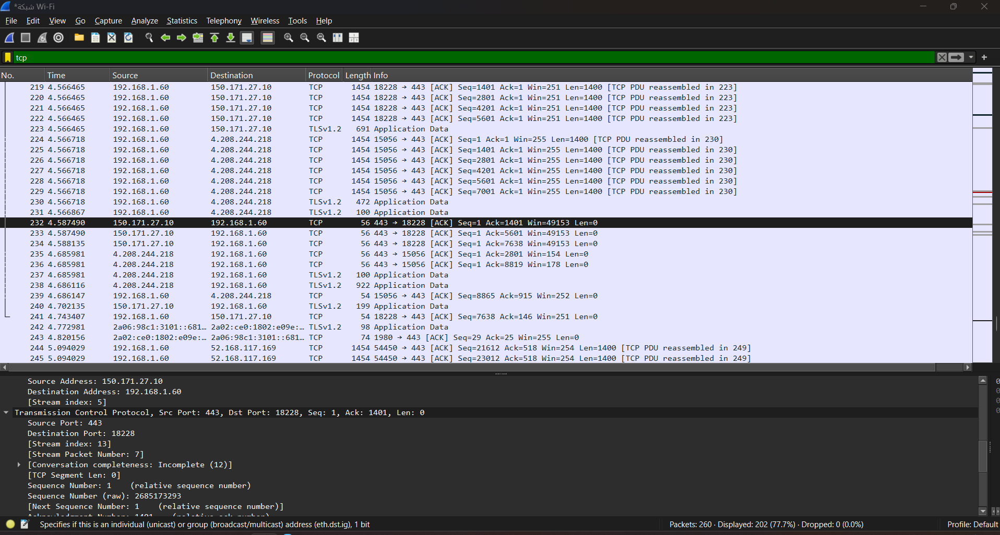
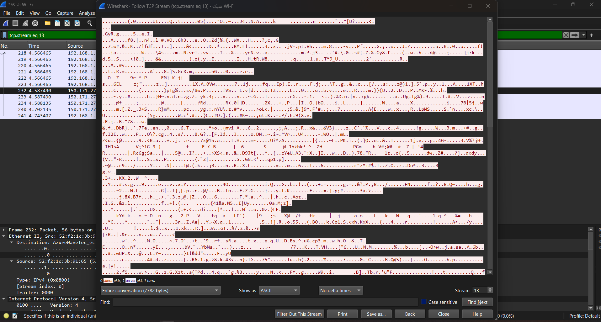

# Case File 01: Investigating Network Traffic with Wireshark

## Case Overview

| Case Detail | Information |
|---|---|
| Case ID | CF-01 |
| Project | AISOP — Phase 6 |
| Investigation Type | Home-lab network traffic review |
| Analyst | alaa819 (repository account) |
| Alert Source | Training exercise; no security alert supplied |
| Severity | Not assigned from screenshot evidence alone |
| Status | Screenshot review completed; capture metadata outstanding |
| Affected Host | Captured local IPv4 endpoint: `192.168.1.60` |
| Tool | Wireshark 4.6.0, shown on the welcome screen |
| Capture Interface | Wi-Fi, as shown in the capture window title |
| Final Disposition | DNS and encrypted traffic documented; security classification inconclusive |

## Case Summary

I collected seven screenshots from Wireshark to document interface selection, captured traffic, protocol identification, DNS exchanges, a TCP handshake, TCP header fields, and a followed TCP stream. This report describes what those screenshots show; the original packet capture was not supplied for independent analysis.

The visible traffic includes DNS, TCP, TLSv1.2, TLSv1.3, QUIC, IPv4, and IPv6. The local IPv4 endpoint is `192.168.1.60`. DNS exchanges use `86.51.34.24`, and a complete three-way TCP handshake is visible with `40.79.163.154:443`. A separate connection to `150.171.27.10:443` is shown in TCP stream 13. These observations do not establish that all captured traffic is benign.

## Investigation Objective

Identify the capture interface and observed protocols, document DNS request/response behavior, examine a TCP connection and header, and follow a stream. Support each observation with screenshot and packet references while recording visibility limits.

## Evidence Collected

| Step | Evidence | Filename |
|---|---|---|
| 1 | Wireshark welcome screen and interfaces | `01-wireshark-interfaces.png` |
| 2 | Captured traffic overview | `02-live-packet-capture.png` |
| 3 | Protocol and endpoint identification | `03-protocol-identification.png` |
| 4 | DNS-filtered traffic | `04-dns-traffic-filter.png` |
| 5 | TCP handshake | `05-tcp-handshake.png` |
| 6 | TCP header analysis | `06-tcp-header-analysis.png` |
| 7 | Follow TCP Stream output | `07-follow-tcp-stream.png` |

The images are user-supplied screenshots, published without alteration. Screenshot 2 documents captured packets; it does not independently prove the capture was running at the moment the screenshot was taken. Visible local paths and network identifiers are retained in these originals.

## Network Indicators

These are observed endpoints and names, not indicators confirmed to be malicious.

| Type | Indicators Observed |
|---|---|
| Local IPv4 endpoint | `192.168.1.60` |
| DNS endpoint | `86.51.34.24`; its role as a router is not established |
| External IPv4 endpoints visible in packet lists | `40.79.163.154`, `150.171.27.10`, `4.208.244.218`, `52.168.117.169`, `44.227.6.15` |
| Additional IPv4 answer in DNS | `102.132.97.54` for `web.whatsapp.com`, via a CNAME |
| Queried names | `events.telemetry.data.nvidia.com`, `web.whatsapp.com`, `wpad.Home`, `mobile.events.data.microsoft.com` |
| CNAME visible in DNS responses | `mmx-ds.cdn.whatsapp.net` |
| TLS Client Hello SNI | `mobile.events.data.microsoft.com` in packet 167 |
| Ports shown | UDP source `53` in DNS response packet 162; TCP server `443`; client ports include `28464`, `28465`, `18228`, `15056`, `54450`, and `64547` |
| Protocols and layers | Ethernet II, IPv4, IPv6, UDP, DNS, TCP, TLSv1.2, TLSv1.3, QUIC |

Some IPv6 addresses are truncated in packet-list columns. They are not reconstructed or attributed to particular services here. DNS answers are distinguished from endpoints observed exchanging TCP traffic.

## Investigation Timeline

Times below are the relative values displayed by Wireshark, not wall-clock timestamps or a verified total capture duration.

| Step | Action / Evidence | Result |
|---|---|---|
| 1 | Review welcome screen | Interfaces and Wireshark 4.6.0 visible; capture views subsequently show Wi-Fi |
| 2 | Review captured packet list | IPv4/IPv6 traffic and TCP/TLS/QUIC visible |
| 3 | Review protocol overview | 260 packets shown; packet 179 exposes IPv6/TCP details |
| 4 | Apply `dns` | 18 displayed packets (6.9%); NVIDIA A query/response at 0.560621 / 0.580066 seconds |
| 5 | Review `tcp` | SYN 163 at 3.494909 s; SYN-ACK 165 at 3.763065 s; ACK 166 at 3.763159 s |
| 6 | Inspect packet 232 | At 4.587490 s, server ACK in TCP stream 13 with no TCP payload |
| 7 | Follow `tcp.stream eq 13` | Dialog reports 7,782 bytes; 6 client packets, 1 server packet, and 1 turn |
| 8 | Assess screenshot evidence | Documented observations; full-capture security assessment remains inconclusive |

## Investigation Workflow



## Evidence and Analysis

### Step 1 — Identified the Active Network Interface

The welcome screen shows Wi-Fi, a loopback capture adapter, virtual/local interfaces, Bluetooth networking, and Ethernet 2. Wi-Fi has a visible activity graph. The later capture window title identifies Wi-Fi as the capture interface. The highlighted row on the welcome screen is a different local interface; the highlight alone is not used to determine the interface captured. Wireshark version 4.6.0 appears at the bottom of the welcome screen.



### Step 2 — Started the Live Packet Capture

The supplied overview shows captured traffic including QUIC and TLSv1.2, with TCP acknowledgments and a FIN-ACK. The lower pane displays frame 1: IPv4 traffic from `192.168.1.60:54450` to `52.168.117.169:443`, with a TCP segment length of 35 and a TLS layer. Frame 1 remains selected in the details pane while the list is scrolled to later packets; those views must not be treated as the same packet.

The screenshot establishes that packets were captured. Capture start/stop time, total duration, the exact activity performed, and whether collection was still running in this view are not established.



### Step 3 — Reviewed Protocols and Network Addresses

With the display filter empty, the list shows TCP, TLSv1.2, TLSv1.3, and QUIC. Packet 179 is selected; its lower pane identifies IPv6 and TCP, source port `64547`, destination port `443`, sequence `7858`, acknowledgment `10447`, and TCP segment length `0`. The packet list labels it ACK.

Packet 191 is labeled TLSv1.3 with Server Hello / Change Cipher Spec. Packet 192 shows IPv4 TCP from `192.168.1.60:28465` to `40.79.163.154:443`. The status bar reports 260 packets and 0 dropped packets.



### Step 4 — Filtered DNS Traffic

Applied display filter:

```text
dns
```

The status bar shows 18 displayed packets out of 260 (6.9%). Packet 11 is an A query from `192.168.1.60` to `86.51.34.24` for `events.telemetry.data.nvidia.com`, transaction ID `0x5eca`. Packet 13 is its response and contains A address `44.227.6.15`. Packet 12 is a separate AAAA query for the same name, with transaction ID `0x25c6`; packet 14 shows its response with an SOA record.

Packets 19–24 show HTTPS, AAAA, and A queries/responses for `web.whatsapp.com`. The A response includes CNAME `mmx-ds.cdn.whatsapp.net` and address `102.132.97.54`. Queries for `wpad.Home` in packets 28–29 receive “No such name” responses in packets 30–31. Packet 159 contains an A query for `mobile.events.data.microsoft.com`.

The lower pane separately displays DNS response frame 162, from `86.51.34.24` to `192.168.1.60`, using UDP source port `53` and destination port `62762`. Its DNS details are collapsed, so no response code or answer is assigned to that frame here.



### Step 5 — Analyzed a TCP Connection

Applied display filter:

```text
tcp
```

Three packet-list entries show connection establishment between `192.168.1.60:28465` and `40.79.163.154:443`:

| Packet | Direction | Flags | Displayed relative sequence / acknowledgment |
|---|---|---|---|
| 163 | Local host → server | SYN | Seq=0 |
| 165 | Server → local host | SYN, ACK | Seq=0, Ack=1 |
| 166 | Local host → server | ACK | Seq=1, Ack=1 |

Packet 167 then shows a TLSv1.3 Client Hello with SNI `mobile.events.data.microsoft.com`. This links the visible handshake to a named TLS connection but does not establish the contents of its later encrypted application traffic.



### Step 6 — Examined the TCP Header

Packet 232 belongs to a different connection from Step 5: `150.171.27.10:443` → `192.168.1.60:18228`. Its expanded TCP details show TCP stream index `13`, stream packet number `7`, and “Conversation completeness: Incomplete (12).” The `Stream index: 5` above the TCP section belongs to the IPv4 layer, not the TCP stream.

| TCP field | Visible value |
|---|---|
| Flags | ACK in the packet list |
| Sequence number | 1, relative |
| Acknowledgment number | 1401 in the packet list |
| Window | 49153 in the packet-list summary; scaling is not established here |
| TCP segment length | 0 |
| Frame length | 56 bytes |

This packet acknowledges traffic without carrying TCP application payload. Other packets in this connection are labeled TLSv1.2. The `tcp` view displays 202 packets (77.7% of 260); this filter also includes packets dissected as TLS over TCP.



### Step 7 — Followed a TCP Stream

Applied stream filter:

```text
tcp.stream eq 13
```

The Follow TCP Stream dialog reports an entire conversation of **7,782 bytes**, **6 client packets**, **1 server packet**, and **1 turn**. The output is displayed as ASCII and is largely unreadable binary data. The associated packet list labels data in this connection TLSv1.2, supporting an interpretation of encrypted application data. The screenshot does not reveal readable application requests or responses, and following TCP does not decrypt TLS.

TCP stream 13 is the `192.168.1.60:18228` / `150.171.27.10:443` connection from Step 6, not the handshake connection from Step 5. The incomplete-conversation indication in packet 232 limits conclusions about the complete session.



## Investigation Findings

- The capture views identify Wi-Fi and show local IPv4 endpoint `192.168.1.60`; the welcome screen reports Wireshark 4.6.0.
- DNS exchanges with `86.51.34.24` include A, AAAA, and HTTPS record queries. Packets 11/13 show an NVIDIA domain A query/answer; packets 28–31 show unsuccessful resolution of `wpad.Home`.
- IPv4, IPv6, TCP, UDP/DNS, TLSv1.2, TLSv1.3, and QUIC are visible across the evidence.
- Packets 163, 165, and 166 show a complete three-way handshake with `40.79.163.154:443`; packet 167 shows the subsequent Client Hello SNI.
- Packet 232 is an ACK with no TCP payload in a separate TCP stream, index 13. Wireshark marks that conversation incomplete.
- Follow TCP Stream 13 reports 7,782 bytes and largely unreadable ASCII output. The associated TLS labeling supports encrypted traffic, not a claim about its application content.
- The status bars report 260 captured packets and 0 dropped packets in the views where those counters are visible. These counters do not prove that all network traffic or all connection establishment was captured.

## Analyst Assessment

The screenshots document name resolution, encrypted connections, acknowledgments, connection establishment, and connection teardown activity. Some visible names refer to recognizable services, but service names and port 443 alone do not establish that traffic is benign.

No specific malicious behavior is demonstrated by the supplied screenshots. This is a limited evidence statement, not proof that no malicious activity occurred. Payloads are largely encrypted, only selected packet ranges are shown, stream 13 is incomplete, and the original capture has not been independently reviewed. A host-wide or network-wide security verdict is not supported.

## Actions Taken

- Collected and added seven original Wireshark screenshots.
- Identified visible protocols, endpoints, DNS exchanges, and packet references.
- Documented the handshake in packets 163, 165, and 166.
- Examined packet 232 and followed its separate TCP stream 13.
- Updated the case report to distinguish direct observations from unverified metadata.
- Published screenshots only; no raw packet capture or decryption secrets were added.

## Final Disposition

| **Closure Detail** | **Result** |
|---|---|
| Case status | Closed |
| Severity | Informational |
| Activity classification | Normal network activity |
| Malicious activity identified | No |
| Containment required | No |
| Escalation required | No<br> |

## Case Closure Notes

The screenshot documentation is complete. The case is not recorded as a confirmed benign incident or a fully verified capture analysis.

The following information remains unverified because it is not established by these images: exact OS/version, capture date/time/timezone, start and stop times, total duration, capture filter, deliberate test activity, original capture filename and SHA-256 hash. The analyst field uses the repository account rather than an inferred personal name. See [Capture Handling](captures/README.md) for the remaining metadata record.
