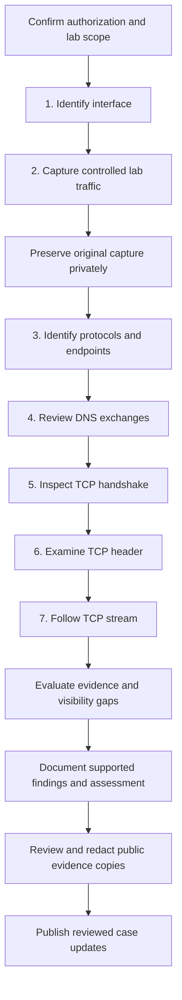

# Case File 01: Investigating Network Traffic with Wireshark

## Case Overview

| Case Detail | Information |
|---|---|
| Case ID | CF-01 |
| Project | AISOP — Phase 6 |
| Investigation Type | Planned home-lab network traffic review |
| Analyst | Pending confirmation |
| Alert Source | Planned training exercise; no alert supplied |
| Severity | Pending assessment |
| Status | Prepared — capture and analysis pending |
| Affected Host | Pending actual test |
| Tool | Wireshark — version pending verification |
| Capture Interface | Pending selection |
| Capture Date and Timezone | Pending actual test |
| Final Disposition | Pending evidence review |

## Case Summary

This case will document an authorized Wireshark investigation of my lab traffic. The test will cover interface selection, packet capture, protocol identification, DNS analysis, TCP connection review, and stream inspection.

The test has not been performed. All host details, observations, screenshots, and conclusions remain pending until my own evidence is collected and reviewed.

## Investigation Objective

Identify the interface carrying the authorized lab activity, collect a short capture, examine network indicators and DNS/TCP behavior, and reach a conclusion supported by the packets reviewed. Record visibility gaps and distinguish observations from interpretations.

## Evidence Collected

**Collection pending.** These are the seven planned evidence items; filenames are placeholders only. The `case-files/CF-01-network-traffic-analysis/evidence/` folder currently contains only `.gitkeep`. No screenshot images have been created or copied.

| Step | Evidence | Planned filename |
|---|---|---|
| 1 | Available Wireshark interfaces | `01-wireshark-interfaces.png` |
| 2 | Live packet capture | `02-live-packet-capture.png` |
| 3 | Protocol and endpoint identification | `03-protocol-identification.png` |
| 4 | DNS-filtered traffic | `04-dns-traffic-filter.png` |
| 5 | TCP connection and handshake | `05-tcp-handshake.png` |
| 6 | TCP header details | `06-tcp-header-analysis.png` |
| 7 | Follow TCP Stream output | `07-follow-tcp-stream.png` |

## Network Indicators

| Type | Indicators Observed |
|---|---|
| Internal host | Pending actual capture |
| Router/DNS server | Pending actual capture |
| External IP addresses | Pending actual capture |
| Domains/hostnames | Pending actual capture |
| Ports | Pending actual capture |
| Protocols | Pending actual capture |

## Investigation Timeline

The actions below are planned, not completed. Record timestamps and packet references during the test.

| Step | Action | Result |
|---|---|---|
| 1 | Identify the active lab interface | Pending |
| 2 | Start and stop a controlled packet capture | Pending |
| 3 | Review protocols and addresses | Pending |
| 4 | Apply the `dns` display filter | Pending |
| 5 | Apply `tcp` and inspect one connection | Pending |
| 6 | Expand a TCP header | Pending |
| 7 | Follow the selected TCP stream | Pending |
| 8 | Evaluate the evidence and record limitations | Pending |

## Investigation Workflow

This diagram describes the planned investigation method.



## Evidence and Analysis

### Step 1 — Identified the Active Network Interface

**Analysis pending.** During the test, review the available interfaces and record which one carries the authorized lab traffic. Explain the selection, including any VPN or virtual adapter that affects visibility.

**Screenshot pending:** `case-files/CF-01-network-traffic-analysis/evidence/01-wireshark-interfaces.png`

### Step 2 — Started the Live Packet Capture

**Analysis pending.** Record the controlled activity, capture start and stop times with timezone, duration, packet count, any capture filter, and any dropped-packet indication. Preserve the original privately and record its filename and SHA-256 hash.

**Screenshot pending:** `case-files/CF-01-network-traffic-analysis/evidence/02-live-packet-capture.png`

### Step 3 — Reviewed Protocols and Network Addresses

**Analysis pending.** Review the Protocol, Source, Destination, and Info columns. Document only observed protocols and endpoints, with representative packet numbers and timestamps. Distinguish deliberate test activity from background communication where possible.

**Screenshot pending:** `case-files/CF-01-network-traffic-analysis/evidence/03-protocol-identification.png`

### Step 4 — Filtered DNS Traffic

Planned Wireshark display filter:

```text
dns
```

**Analysis pending.** If DNS packets are present, correlate queries and responses using endpoints and transaction details. Record query names, record types, response codes, and returned records. If none are visible, document that limitation; caching or encrypted DNS can affect visibility.

**Screenshot pending:** `case-files/CF-01-network-traffic-analysis/evidence/04-dns-traffic-filter.png`

### Step 5 — Analyzed a TCP Connection

Planned Wireshark display filter:

```text
tcp
```

**Analysis pending.** Select an actual connection and isolate its stream using `tcp.stream eq N`, replacing `N` with the observed numeric index. Record endpoints, ports, and the packet numbers for SYN, SYN-ACK, and ACK if all three are captured. Report an incomplete handshake honestly if the capture misses establishment.

**Screenshot pending:** `case-files/CF-01-network-traffic-analysis/evidence/05-tcp-handshake.png`

### Step 6 — Examined the TCP Header

**Analysis pending.** Expand a selected TCP packet and record its ports, flags, sequence and acknowledgment values, window information, and segment length. State whether sequence numbers are relative, and explain the selected packet in the context of its connection.

**Screenshot pending:** `case-files/CF-01-network-traffic-analysis/evidence/06-tcp-header-analysis.png`

### Step 7 — Followed a TCP Stream

**Analysis pending.** Use Follow TCP Stream on the selected connection. Record the actual stream index, endpoints, directions, and any visible application content. Explain encryption or reassembly limitations; following a TCP stream does not decrypt TLS.

**Screenshot pending:** `case-files/CF-01-network-traffic-analysis/evidence/07-follow-tcp-stream.png`

## Investigation Findings

- Host and network configuration: **Pending**.
- Observed protocols, addresses, domains, and ports: **Pending**.
- DNS query and response behavior: **Pending**.
- TCP handshake and header observations: **Pending**.
- TCP stream observations and encryption limitations: **Pending**.
- Behaviors requiring further investigation: **Pending**.

Each completed finding will cite screenshots and packet references from my own capture. No traffic observations from the reference case are used as results here.

## Analyst Assessment

**Pending actual capture and analysis.** No benign or malicious classification has been assigned, and no claim of absence of compromise is made.

The assessment will consider the capture scope, duration, vantage point, encryption, missing packets, and background activity. A familiar domain, an IP address, or a port alone is not enough to determine whether traffic is safe or malicious. Conclusions will apply to the reviewed sample.

## Actions Taken

- Prepared the case report and seven evidence placeholders.
- Added the investigation workflow to this root case-report README.
- Documented private capture handling and publication requirements.

Capture, filtering, packet analysis, screenshot collection, and operational response decisions are **pending**.

## Final Disposition

| Closure Detail | Result |
|---|---|
| Case status | Prepared — test pending |
| Severity | Pending assessment |
| Activity classification | Pending evidence review |
| Malicious activity identified | Not yet assessed |
| Containment required | Not yet assessed |
| Escalation required | Not yet assessed |

## Case Closure Notes

**Not closed.** Complete this section after the test, explaining the evidence supporting the final decision, unresolved questions, and any follow-up required. If evidence is unavailable or inconclusive, record that limitation instead of inventing a result.
