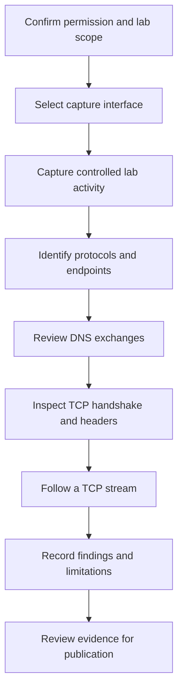

# AISOP — Network Traffic Investigation with Wireshark

An evidence-led network analysis portfolio: capture authorized lab traffic, examine how hosts communicate, and document conclusions that can be traced back to packets.

**Phase 6 · Case File 01 · Status: prepared; capture pending**

This standalone project contains the investigation framework. No traffic has been captured or analyzed for this case yet. Screenshots, network indicators, findings, and the final assessment remain pending.

## Featured case

[CF-01 — Network Traffic Analysis](case-files/CF-01-network-traffic-analysis/README.md) follows seven evidence steps: interface selection, live capture, protocol identification, DNS review, TCP handshake analysis, TCP header inspection, and TCP stream review.

The goal is to demonstrate a reproducible investigation and honest reporting. Results will depend on the actual lab environment; they are not expected to match another analyst's addresses, packet numbers, or conclusions.

## Repository layout

```text
aisop-network-traffic-investigation/
├── README.md
├── case-files/
│   └── CF-01-network-traffic-analysis/
│       ├── README.md
│       ├── evidence/
│       │   └── .gitkeep
│       └── diagrams/
│           └── investigation-flow.md
├── captures/
│   └── README.md
└── .gitignore
```

The seven planned screenshot filenames are documented in the case file. Image files will only be added after real evidence is captured and reviewed.

## Investigation workflow



[Workflow and evidence mapping](case-files/CF-01-network-traffic-analysis/diagrams/investigation-flow.md)

## Methodology

1. Define an authorized host, interface, capture window, and controlled activity.
2. Preserve the original capture privately and record its provenance and SHA-256 hash.
3. Use display filters to investigate specific questions while retaining the original packet context.
4. Link each observation to packet numbers, timestamps, and evidence references.
5. Separate direct observations from interpretations; record missing visibility and alternative explanations.
6. Publish only reviewed evidence and a conclusion supported by the scope of the capture.

## Publication standard

Capture only traffic you own or have explicit permission to inspect. Use a controlled lab without sensitive accounts or unrelated users. Review screenshots for addresses, hostnames, usernames, credentials, cookies, tokens, URLs, payloads, and identifying desktop details before publication. Redact public copies while preserving originals privately; disclose redactions in captions.

Raw captures and decryption secrets are excluded by default. A `.gitignore` does not remove files already tracked by Git: review staged files before every commit. See [capture handling](captures/README.md).

## Progress

- [x] Step 1: prepare the standalone project and case documentation.
- [ ] Step 2: collect and review seven real Wireshark screenshots.
- [ ] Record packet-backed findings and limitations.
- [ ] Review evidence and approve publication.

## Inspiration

The case-file approach was inspired by [JFrancisSOC's Wireshark investigation](https://github.com/JFrancisSOC/Case-File-01-Investigating-Network-Traffic-with-WireShark). This project uses original documentation and will use independently collected evidence. No reference images or traffic observations are reproduced.
