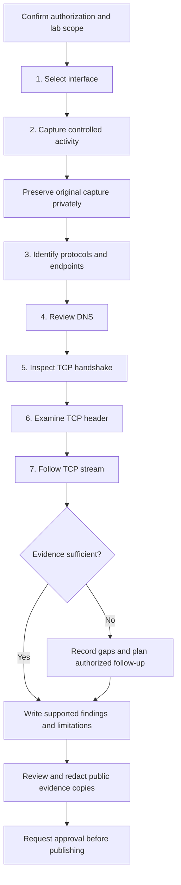

# CF-01 Investigation Workflow

[Case file](../../../README.md)

The primary [Investigation Workflow](../../../README.md#investigation-workflow) is now embedded directly in the root case-report README. This companion diagram describes the planned method, not completed activity or observed traffic.

Steps 1–7 map to the seven planned screenshot filenames in the [Evidence Collected](../../../README.md#evidence-collected). Any unobserved behavior must be documented as unavailable or inconclusive. Publication review must preserve the distinction between original private evidence and redacted public copies.
