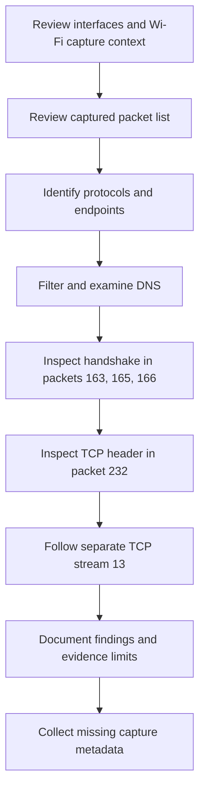

# CF-01 Investigation Workflow

[Case report](../../../README.md#investigation-workflow)

This mirrors the workflow embedded in the root case report. The handshake and followed stream are separate connections.

